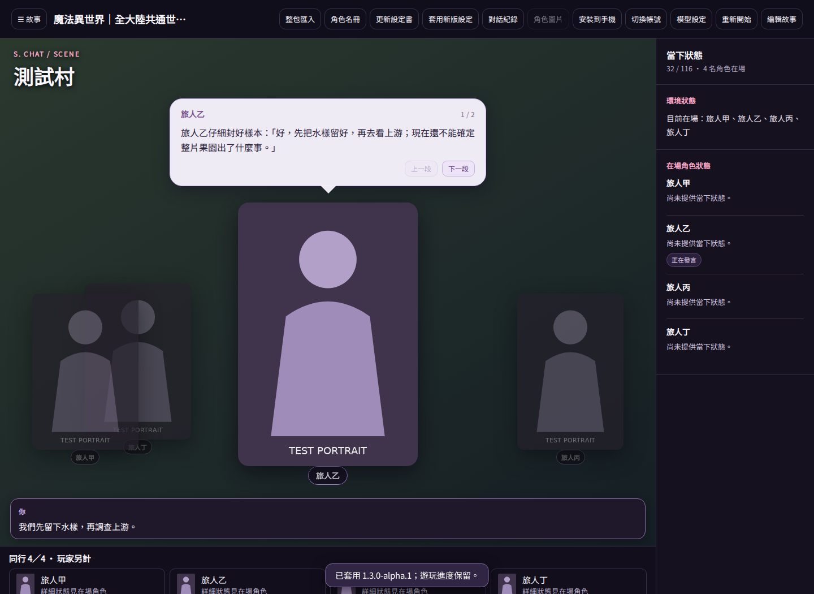
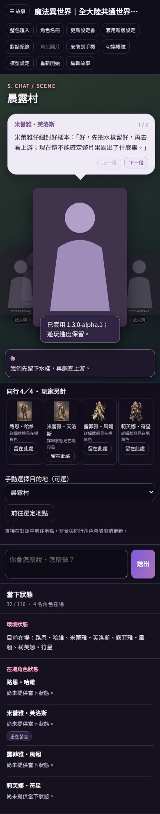

# S.Chat 整合設定 Alpha 1

新版世界設定可以隨首次世界匯入安裝，既有世界也能按「套用新版設定」載入完整測試資料 ZIP。安裝前備份故事定義，只替換版本化作者內容，既有 session、原始角色、圖片與模型憑證保持原樣。

## 此版本可測

- 玩家另計，最多四位同行。手動加入與敘事旅行都檢查上限；舊存檔超額時保留所有人，需先安排留守。
- 每位實際見聞者獨立累計，通常八次整合，換場段落五次後可提前；故事旅程另有獨立紀要。
- 摘要失敗保留原文及待處理工作，不取消已成功的互動；重試已接受事件不再次生成、扣資源或建摘要。
- 完整原始互動按事件保存於當前使用者資料的 archives，近期對話仍有合理上限。角色讀取自己最近與相關的少量記憶，不讀別人的私密內容。
- 一般畫面顯示玩家已知旅程紀要，角色私密記憶不在歷史面板全部列出。
- 延續前一版本的大型發言立繪、多人同場與劇情換場；新增四格同行與版本化設定更新入口。
- 新能力方向只給對應角色，作者歷史方向只供導演。任務、敵人與物品目錄作為版本化作者內容保存。

## 資料格式

世界底層及素材版本維持 1.0.0，內容版本另記 1.3.0-alpha.1，避免破壞原 ID 與圖片綁定。完整資料包額外提供唯一的 release/content.json；JSON 索引限制 1 MiB，HTTP 設定更新限制 8 MiB。

更新需提供當前 content_version；相同內容重送去重，過期版本拒絕覆蓋。角色方向 ID 必須與故事全部重要角色一致，隊伍與摘要核心規則不可由檔案放寬成任意值。ZIP 延續既有資料檢查，不執行檔內程式。

## 驗證

Python 全量回歸：1092 passed、1 skipped、4 deselected、5 xfailed。Node 名冊與分段發言檢查 12 項通過；JavaScript 語法、Python 編譯、差異空白與秘密掃描通過。

隔離 Chromium 使用實際 195 張 WebP 和完整新版資料包，通過首次匯入、既有世界套用、四格同行、旅程紀要、第五人拒絕及手機水平寬度檢查。手機焦點角色至少 280 像素高、200 像素寬；桌面／手機畫面已檢視。下列截圖以測試占位圖替代使用者素材，原始圖片、完整設定書與遊玩資料不提交 Git。

## 尚待實作與人工驗收

完整數值戰鬥、物品背包／裝備／掉落執行器、自動任務狀態機、全角色技能數值與四個擴充地區仍未完成；本版不把作者目錄誤標為已可實戰的完整 RPG。傷勢、交易與承諾的通用結構化執行仍需後續模組，摘要不能取代它們。

本次沒有真實聊天 API 呼叫；原模型在使用者裝置上。需驗證摘要忠實度、人物自主與角色品質，並在 Windows 實機測試安裝、長篇遊玩及存檔。Windows 工作流程產生候選測試包，不表示已完成人工驗收或正式上架。
